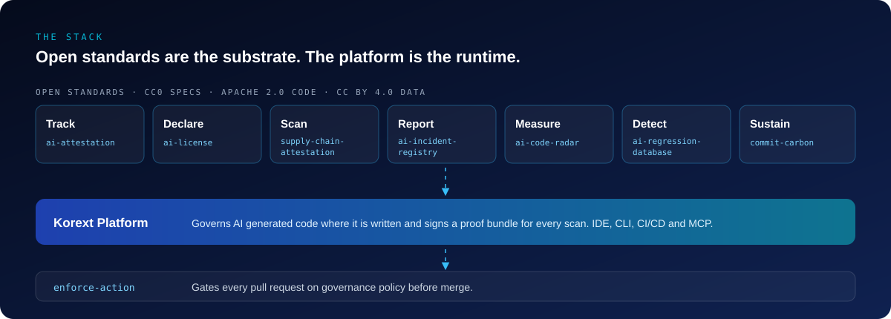

  

  

<b>AI ECOSYSTEMS</b> &nbsp;·&nbsp; <b>CONTEXT FOR AFRICA</b> &nbsp;·&nbsp; <b>OPEN STANDARDS</b>

<a href="#about">About</a> &nbsp;·&nbsp; <a href="#ace-the-african-context-engine">ACE</a> &nbsp;·&nbsp; <a href="#inclusive-skin-ai">Skin AI</a> &nbsp;·&nbsp; <a href="#korext-the-stack">Korext</a> &nbsp;·&nbsp; <a href="#journey">Journey</a> &nbsp;·&nbsp; <a href="#connect">Connect</a>

 

## About

I work where AI systems meet the ecosystems around them: the agents, platforms, publishers and developers that have to trust one another for any of it to work.

By day I am a Product and Ecosystem Leader in AI Ecosystems. Outside of it I am building **[ACE](#ace-the-african-context-engine)**, an open context engine that grounds AI in hyperlocal African knowledge, and **[Korext](https://korext.com)**, a governance runtime for AI generated code with **[seven open standards](https://oss.korext.com)** that make AI written software traceable, licensable and accountable.

 

<table>
<tr>
<td width="50%" valign="top">

01 &nbsp; DAY JOB

### AI Ecosystems

How agents, platforms and publishers connect: access, identity, incentives and the protocols that hold them together.

</td>
<td width="50%" valign="top">

02 &nbsp; BUILDING

### ACE, the African Context Engine

One open context engine behind every entry point people already use: voice, USSD, SMS, WhatsApp, agents, radio and MCP.

Pre-alpha. Repository opening soon.

</td>
</tr>
<tr>
<td width="50%" valign="top">

03 &nbsp; OPEN SOURCE

### Korext Standards

Seven open standards for AI code provenance. CC0 specifications, Apache 2.0 code, CC BY 4.0 data.

<a href="https://oss.korext.com"><b>oss.korext.com →</b></a>

</td>
<td width="50%" valign="top">

04 &nbsp; COMPANY

### Korext Platform

The runtime that enforces those standards for regulated industries, with a signed proof bundle for every scan.

<a href="https://korext.com"><b>korext.com →</b></a>

</td>
</tr>
</table>

 

## ACE: the African Context Engine

Global models do not know which pest control works at 2,100m in the Rift Valley, what tomatoes cost on Thursdays at Wakulima, or how land law changes 30km across a border. ACE encodes that hyperlocal knowledge once and serves it through every channel, on any phone, with a safety rail that hands urgent cases to a human.

Open core: the engine is free; verified, expert reviewed context carries commercial terms. Pre-alpha. Repository opening soon.

  

## Inclusive Skin AI

Most skin analysis models are trained on lighter skin, so they misread darker tones and give advice that does not fit. This project starts from the other end: an end to end system built for melanin-rich skin first, from photo capture and labeling to trained models and a personalized skincare assistant.

<table>
<thead>
<tr><th align="left">Layer</th><th align="left">Repository</th><th align="left">What it does</th></tr>
</thead>
<tbody>
<tr><td>MODEL</td><td><a href="https://github.com/tbrunoh/ml-ai-skintone"><b>ml-ai-skintone</b></a></td><td>Skin tone classifier on the Monk Skin Tone scale, with training and Vertex AI inference</td></tr>
<tr><td>MODEL</td><td><a href="https://github.com/tbrunoh/ml-ai-skin-conditions"><b>ml-ai-skin-conditions</b></a></td><td>Skin condition model package, early stage</td></tr>
<tr><td>CORE</td><td><a href="https://github.com/tbrunoh/ml-ai-core"><b>ml-ai-core</b></a></td><td>Shared Python library for models, utilities and image storage</td></tr>
<tr><td>PRODUCT</td><td><a href="https://github.com/tbrunoh/ml-ai-skintone-ui"><b>ml-ai-skintone-ui</b></a></td><td>Next.js app for skin tone analysis, deployed by CI/CD on every push</td></tr>
<tr><td>RESEARCH</td><td><a href="https://github.com/tbrunoh/ml-ai-samples"><b>ml-ai-samples</b></a></td><td>Reference experiments: class prediction, GANs and MNIST baselines</td></tr>
</tbody>
</table>

The upload API, labeling service, inference API and Terraform infrastructure stay private.

  

## Korext: The Stack

 

## Korext Open Standards

<table>
<thead>
<tr><th align="left">Role</th><th align="left">Standard</th><th align="left">What it does</th><th align="left">Release</th></tr>
</thead>
<tbody>
<tr>
<td>TRACK</td>
<td><a href="https://github.com/korext/ai-attestation"><b>ai-attestation</b></a></td>
<td>Verifiable provenance for the leading AI coding tools</td>
<td></td>
</tr>
<tr>
<td>DECLARE</td>
<td><a href="https://github.com/korext/ai-license"><b>ai-license</b></a></td>
<td>Licensing framework for AI generated code</td>
<td></td>
</tr>
<tr>
<td>SCAN</td>
<td><a href="https://github.com/korext/supply-chain-attestation"><b>supply-chain-attestation</b></a></td>
<td>AI provenance across SBOM and signature ecosystems</td>
<td></td>
</tr>
<tr>
<td>REPORT</td>
<td><a href="https://github.com/korext/ai-incident-registry"><b>ai-incident-registry</b></a></td>
<td>Public incident taxonomy and registry for AI code failures</td>
<td></td>
</tr>
<tr>
<td>MEASURE</td>
<td><a href="https://github.com/korext/ai-code-radar"><b>ai-code-radar</b></a></td>
<td>Detection pattern library and live adoption data for AI authored code</td>
<td></td>
</tr>
<tr>
<td>DETECT</td>
<td><a href="https://github.com/korext/ai-regression-database"><b>ai-regression-database</b></a></td>
<td>Regression fingerprinting for AI code patterns</td>
<td></td>
</tr>
<tr>
<td>SUSTAIN</td>
<td><a href="https://github.com/korext/commit-carbon"><b>commit-carbon</b></a></td>
<td>Emissions accounting for software changes</td>
<td></td>
</tr>
</tbody>
</table>

Specifications CC0 &nbsp;·&nbsp; Code Apache 2.0 &nbsp;·&nbsp; Data CC BY 4.0 &nbsp;·&nbsp; Built so anyone can adopt, extend and contribute back without legal friction.

  

## Journey

 

Born and raised in Kenya. More than a decade at Google, including five years shaping product and platform strategy for Chrome, used by billions of people. I invest in technology led founders in frontier markets with Black Angel Group and advise Silicon Xchange, which connects Silicon Valley and Africa.

 

## Connect

 

---

<i>The next decade of software gets written faster than humans can review it. Infrastructure for accountability has to ship at the same pace as the agents producing the code.</i>

