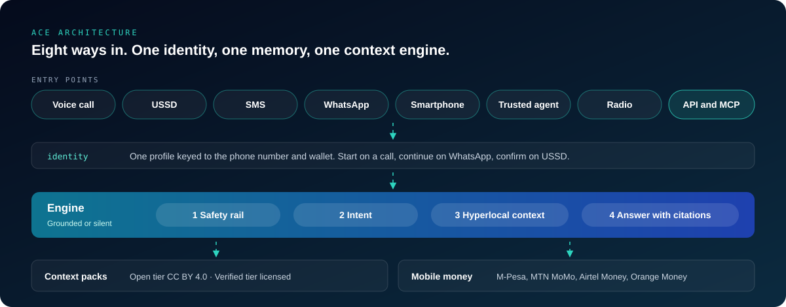
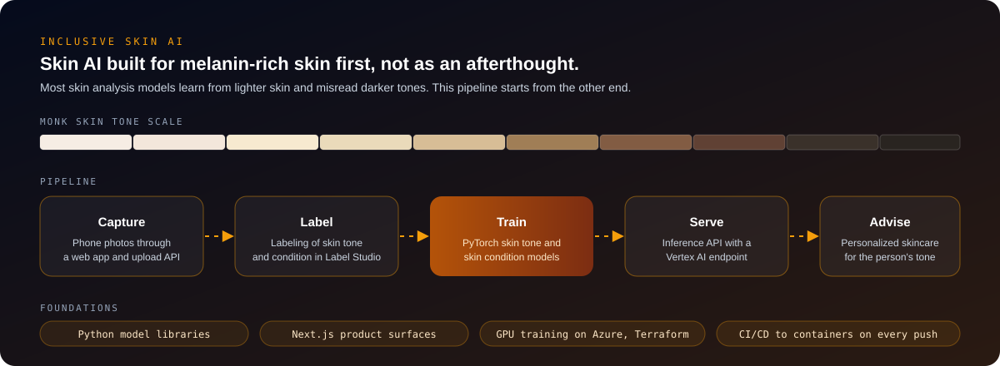
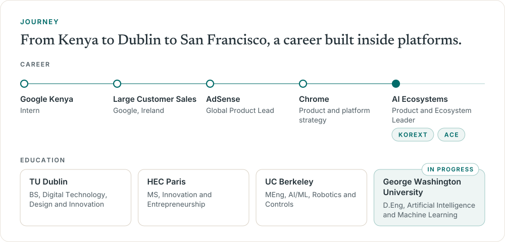

  

  

<b>AI ECOSYSTEMS</b> &nbsp;·&nbsp; <b>CONTEXT FOR AFRICA</b> &nbsp;·&nbsp; <b>OPEN STANDARDS</b>

<a href="#about">About</a> &nbsp;·&nbsp; <a href="#ace-the-african-context-engine">ACE</a> &nbsp;·&nbsp; <a href="#inclusive-skin-ai">Skin AI</a> &nbsp;·&nbsp; <a href="#korext-the-stack">Korext</a> &nbsp;·&nbsp; <a href="#career">Career</a> &nbsp;·&nbsp; <a href="#connect">Connect</a>

 

## About

By day I am a Product and Ecosystem Leader in AI Ecosystems at Google, where I shape strategy for how AI agents reach the web: what they can access, how they identify themselves, and what publishers and creators get in return. Outside of it, my personal projects are **[ACE](#ace-the-african-context-engine)**, an open context engine that grounds AI in hyperlocal African knowledge; **[Korext](https://korext.com)**, a governance runtime for AI generated code with **[seven open standards](https://oss.korext.com)** that make AI written software traceable, licensable and accountable; and **[Inclusive Skin AI](#inclusive-skin-ai)**, skin analysis built for melanin-rich skin first.

I write about AI that reaches people on the phones they already own, and about getting public data to the people it is meant to serve: **[Writing](https://tbrunoh.github.io/writing/)**.

 

<table>
<tr>
<td width="50%" valign="top">

01 &nbsp; DAY JOB

### AI Ecosystems at Google

How agents, platforms and publishers connect: access, identity, incentives and the protocols that hold them together.

</td>
<td width="50%" valign="top">

02 &nbsp; PERSONAL PROJECT

### ACE, the African Context Engine

Checked, local, citable knowledge for Africa on any phone: USSD, SMS, voice, WhatsApp and MCP. Release 2.2 preview is out: six decision services on public data in 34 countries and eight languages, now tested on real African speech from the open WAXAL corpus, with a voice line that speaks only languages a voice exists for. Open for contributors.

<a href="https://tbrunoh.github.io/ace/"><b>Project page →</b></a> &nbsp; <a href="https://github.com/tbrunoh/african-context-engine"><b>Repository →</b></a>

</td>
</tr>
<tr>
<td width="50%" valign="top">

03 &nbsp; OPEN SOURCE

### Korext Standards

Seven open standards for AI code provenance. CC0 specifications, Apache 2.0 code, CC BY 4.0 data.

<a href="https://oss.korext.com"><b>oss.korext.com →</b></a>

</td>
<td width="50%" valign="top">

04 &nbsp; COMPANY

### Korext Platform

The runtime that enforces those standards for regulated industries, with a signed proof bundle for every scan.

<a href="https://korext.com"><b>korext.com →</b></a>

</td>
</tr>
</table>

 

## ACE: the African Context Engine

Global models do not know which hotline handles gender based violence in Ghana, what moisture keeps maize free of aflatoxin, or how to tell a real mobile money message from a scam. ACE encodes that knowledge in open, sourced packs and serves it on any phone, with a safety rail that answers emergencies with verified numbers before anything else runs. One engine covers 34 countries, from Kenya and Nigeria to Ethiopia, Mozambique and Egypt, in eight languages: English, Swahili, French, Portuguese, Arabic, Amharic, Afaan Oromo and Somali. The caller's number picks the country, so every emergency number is that country's own. It ships a USSD menu app, Scam Shield and an MCP server, and runs without an AI model. [Six decision services](https://github.com/tbrunoh/african-context-engine/blob/main/docs/services.md) run on dated public data: rain this week, official warnings, the nearest health facility, market prices, a pregnancy companion and a crop problem check, each covering every country wherever open data exists and naming the gap where it does not. Release 2.1 added 21 countries and five languages, with Arabic and Amharic replies sized for the smaller alphabet they travel in; the [2.1 design](https://github.com/tbrunoh/african-context-engine/blob/main/docs/v2/release-2.1.md) records every decision and gap. The [V2 design](https://github.com/tbrunoh/african-context-engine/tree/main/docs/v2) sets out the rest, including a voice line in African languages.

Apache 2.0 code, CC BY 4.0 knowledge. Release 2.2 preview is out; speakers of Swahili, French, Portuguese, Arabic, Amharic, Afaan Oromo and Somali, clinicians, agronomists and developers are welcome: <a href="https://tbrunoh.github.io/ace/">project page</a> · <a href="https://github.com/tbrunoh/african-context-engine/issues">starter issues</a> · <a href="https://github.com/tbrunoh/african-context-engine/discussions">discussions</a>.

  

## Inclusive Skin AI

Skin analysis models often perform worse on darker skin, because the images they learn from are mostly of lighter skin. This project starts from the other end: an end to end system built for melanin-rich skin first, from photo capture and labeling to trained models and a personalized skincare assistant.

<table>
<thead>
<tr><th align="left">Layer</th><th align="left">Repository</th><th align="left">What it does</th></tr>
</thead>
<tbody>
<tr><td>MODEL</td><td><a href="https://github.com/tbrunoh/ml-ai-skintone"><b>ml-ai-skintone</b></a></td><td>Skin tone classifier on the Monk Skin Tone scale, with training and Vertex AI inference</td></tr>
<tr><td>MODEL</td><td><a href="https://github.com/tbrunoh/ml-ai-skin-conditions"><b>ml-ai-skin-conditions</b></a></td><td>Skin condition model package, early stage</td></tr>
<tr><td>CORE</td><td><a href="https://github.com/tbrunoh/ml-ai-core"><b>ml-ai-core</b></a></td><td>Shared Python library for models, utilities and image storage</td></tr>
<tr><td>PRODUCT</td><td><a href="https://github.com/tbrunoh/ml-ai-skintone-ui"><b>ml-ai-skintone-ui</b></a></td><td>Next.js app for skin tone analysis, deployed by CI/CD on every push</td></tr>
<tr><td>SERVE</td><td><a href="https://github.com/tbrunoh/ml-ai-client-api"><b>ml-ai-client-api</b></a></td><td>Python inference API that serves the skin tone model</td></tr>
<tr><td>DATA</td><td><a href="https://github.com/tbrunoh/ml-data-upload-api"><b>ml-data-upload-api</b></a></td><td>Upload API that feeds training images into storage and labeling</td></tr>
<tr><td>DATA</td><td><a href="https://github.com/tbrunoh/ml-data-labelling-ui"><b>ml-data-labelling-ui</b></a></td><td>Label Studio deployment for labeling skin tone and condition</td></tr>
<tr><td>INFRA</td><td><a href="https://github.com/tbrunoh/ml-terraform"><b>ml-terraform</b></a></td><td>Terraform for GPU training, storage, databases and container registry on Azure</td></tr>
<tr><td>INFRA</td><td><a href="https://github.com/tbrunoh/ml-terraform-modules"><b>ml-terraform-modules</b></a></td><td>Reusable Terraform modules: storage, PostgreSQL, Cosmos DB and container registry</td></tr>
<tr><td>RESEARCH</td><td><a href="https://github.com/tbrunoh/ml-ai-samples"><b>ml-ai-samples</b></a></td><td>Reference experiments: class prediction, GANs and MNIST baselines</td></tr>
</tbody>
</table>

The cloud environment behind this work has been retired; the code stays open as a reference.

  

## Korext: The Stack

 

## Korext Open Standards

<table>
<thead>
<tr><th align="left">Role</th><th align="left">Standard</th><th align="left">What it does</th><th align="left">Release</th></tr>
</thead>
<tbody>
<tr>
<td>TRACK</td>
<td><a href="https://github.com/korext/ai-attestation"><b>ai-attestation</b></a></td>
<td>Verifiable provenance for the leading AI coding tools</td>
<td></td>
</tr>
<tr>
<td>DECLARE</td>
<td><a href="https://github.com/korext/ai-license"><b>ai-license</b></a></td>
<td>Licensing framework for AI generated code</td>
<td></td>
</tr>
<tr>
<td>SCAN</td>
<td><a href="https://github.com/korext/supply-chain-attestation"><b>supply-chain-attestation</b></a></td>
<td>AI provenance across SBOM and signature ecosystems</td>
<td></td>
</tr>
<tr>
<td>REPORT</td>
<td><a href="https://github.com/korext/ai-incident-registry"><b>ai-incident-registry</b></a></td>
<td>Public incident taxonomy and registry for AI code failures</td>
<td></td>
</tr>
<tr>
<td>MEASURE</td>
<td><a href="https://github.com/korext/ai-code-radar"><b>ai-code-radar</b></a></td>
<td>Detection pattern library and live adoption data for AI authored code</td>
<td></td>
</tr>
<tr>
<td>DETECT</td>
<td><a href="https://github.com/korext/ai-regression-database"><b>ai-regression-database</b></a></td>
<td>Regression fingerprinting for AI code patterns</td>
<td></td>
</tr>
<tr>
<td>SUSTAIN</td>
<td><a href="https://github.com/korext/commit-carbon"><b>commit-carbon</b></a></td>
<td>Emissions accounting for software changes</td>
<td></td>
</tr>
</tbody>
</table>

Specifications CC0 &nbsp;·&nbsp; Code Apache 2.0 &nbsp;·&nbsp; Data CC BY 4.0 &nbsp;·&nbsp; Built so anyone can adopt, extend and contribute back without legal friction.

  

## Career

 

Born and raised in Kenya. More than a decade at Google, including five years shaping product and platform strategy for Chrome, used by billions of people. I invest in technology led founders in frontier markets with Black Angel Group and advise Silicon Xchange, which connects Silicon Valley and Africa.

 

## Connect

 

---

<i>The next decade of software gets written faster than humans can review it. Infrastructure for accountability has to ship at the same pace as the agents producing the code.</i>

